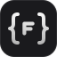

<div align="center">
    
</div>
<h1 align="center">Features</h1>

<div align="center">
    <a href="https://crates.io/crates/features-cli"></a>
    <a href="https://www.npmjs.com/package/features-cli"></a>
</div>

`Features` is a Rust-based Web and CLI tool to explore the features in your projects, visualize their metrics and understand the ownership of each of these features.

It is technology agnostic and can be used with any programming language or framework.

You can: 

- list all the features in a project
- find the team 'owning' a specific feature
- get the history of a feature (git log)
- find the documentation related to the feature
- list the test coverage by feature
- check [the technical debt by feature](./FAQ.md#what-is-the-technical-debt-of-a-feature)
- see statistics about the features like the repartition of feature, fix and refactor commits, lines of code, and files
- generate CODEOWNERS file
- list the feature flags and other feature dependencies

> If you see an other use case, feel free to contribute to this repository.

It also provides a UI to explore the feature. Check a live [demo](http://interaction-dynamics.io/features/).

<a href="http://interaction-dynamics.io/features">
    
</a>

`features-cli` provides a Web Dashboard and also a CLI to generate json reports.
    
## Getting started 

```bash
npx features-cli@latest serve /path/to/project --project-dir ./repository

# or with installation
npm install -g features-cli
# or
cargo binstall features-cli
# then 
features serve /path/to/project --project-dir ./repository
```

Each action is a command. `PATH` is the folder to scan for features and defaults to the current directory:

| Command | Description |
| ------- | ----------- |
| `features scan [PATH]` | List the features (the default action, so `features PATH` works too) |
| `features serve [PATH]` | Start an HTTP server with the web dashboard, refreshed when files change |
| `features build [PATH]` | Build a static version of the web dashboard |
| `features codeowners [PATH]` | Generate or update a CODEOWNERS file with feature ownership information |
| `features find-owner <TARGET> [PATH]` | Find the owner of a specific file or folder |
| `features owners [PATH]` | Display only the unique list of owners |
| `features check [PATH]` | Run validation checks on features (e.g., duplicate names) |

Run `features <command> --help` for the options of a command. The options are:

| Option | Commands | Description |
| ------ | -------- | ----------- |
| `--json` | `scan`, `find-owner`, `owners` | Output as JSON |
| `--flat` | `scan` | Output features as a flat array instead of nested structure |
| `--description` | `scan` | Include feature descriptions in the output |
| `--coverage` | `scan` | Include coverage information in the output (always on with `--json`, `serve` and `build`) |
| `--port <port>` | `serve` | Change the port (default: 3000) |
| `--allow-origin <origin>` | `serve` | Allow another origin (e.g. `http://localhost:5173`) to read the server's data via CORS. Can be repeated; `*` allows any origin. By default no cross-origin access is allowed and the server only answers requests addressed to `localhost`, `127.0.0.1` or `[::1]` |
| `--build-dir <path>` | `build` | Output directory for the static build (default: `build`) |
| `--generate-codeowners` | `serve`, `build`, `check` | Also generate or update the CODEOWNERS file |
| `--codeowners-path <path>` | `codeowners`, and with `--generate-codeowners` | Custom path and filename for CODEOWNERS file (default: `CODEOWNERS` in project directory) |
| `--codeowners-prefix <prefix>` | `codeowners`, and with `--generate-codeowners` | Custom prefix for owner names in CODEOWNERS file (default: `@`) |
| `--project-dir <path>` | all | Project directory for CODEOWNERS generation and additional coverage search locations |
| `--skip-changes` | all | Skip computing git commit history (faster for large repos) |
| `--ignore-path <path>` | all | Ignore a folder and all its subfolders when scanning for features. Can be repeated to ignore multiple folders |
| `--include-skipped-dirs` | all | Also scan folders that are skipped by default (`node_modules`) for features, stats and imports |
| `--coverage-dir <path>` | all | Specify a custom coverage directory (overrides automatic search) |
| `--strip-emails` | all | Remove commit author emails from the output (JSON, `serve` and `build`). Useful before publishing a static build. Author names are kept |

> **Legacy flags.** Before commands existed, actions were flags: `features PATH --serve`, `--build`, `--check`, `--list-owners`, `--find-owner <TARGET>` and `--generate-codeowners`. They still work but are deprecated. Combining two actions (e.g. `--serve --build`) is now an error instead of silently running one of them; `--generate-codeowners` can still be combined with `--serve`, `--build`, `--check` and `--list-owners`.

## Guidelines

By following specific guidelines and conventions, it becomes easier for `features` to find your feature:

### Folder structure

Features can be organized in two ways:

#### Method 1: Features folder (recommended)

Place your features folder in a dedicated `features` folder:

```bash
src/
├── features
│   ├── saveUser
│   │   ├── components/
│   │   │   ├── UserForm.ts
│   │   │   └── EmailInput.ts
│   │   ├── utils/
│   │   │   ├── useSaveUser.ts
│   │   │   ├── useFetchUser.ts
│   │   │   └── transformUser.ts
│   │   └── README.md # a README.md file for large features helps
│   └── feature-2
│       └── ... # ...
├── components # common components used across features
├── utils # common utils/hooks used across features
└── ... # other source code
```

> You can read the detailed [guidelines](./docs/folder-architecture-guidelines.md) or just jump into trying the CLI with `features serve`. The UI will guide you through the methodology.

#### Method 2: Feature flag
Mark any folder as a feature by adding `feature: true` in its README frontmatter:

```yaml
---
feature: true
owner: backend-team
---
```

This allows features to be organized anywhere in your codebase while still being discoverable by the tools.

Conversely, adding `feature: false` skips a folder from being detected as a feature, even if it's a direct subfolder of a `features` folder. Unlike `--ignore-path`, its subfolders are still scanned, so any nested features it contains are still discovered:

```yaml
---
feature: false
---
```

### Feature Metadata Annotations

You can annotate your code with feature metadata using special comments. These annotations can be placed **anywhere in your codebase** and will be automatically associated with the matching feature:

```typescript
// --feature-flag feature: feature-1, name: feature-flag1, type: experiment, owner: team-a, introduced_on: 2025-01-01

export function experimentalLoginFlow() {
  // implementation
}
```

The syntax is: `--feature-<metadata-key> feature:<feature-folder-basename>, property: value, ...`

- **`feature:`** property is optional if the comment is inside a feature folder - it will automatically link to that feature
- **`<metadata-key>`** becomes a tab in the web UI (e.g., `flag`, `experiment`)
- Properties are flexible - add any key-value pairs you need

This works in any programming language:

```python
# --feature-flag name: feature-flag1, type: processing, language: python
```

```rust
// --feature-flag name: feature-flag1, type: core, status: stable
```

```bash
# --feature-flag name: feature-flag1, environment: production, region: us-west-2
```

## Supported Programming Languages

The tool supports feature metadata annotations in the following programming languages: Rust, C/C++, Java, JavaScript/TypeScript, C#, Go, Swift, Kotlin, Scala, CSS/SCSS/Less, Python, Bash/Shell, Ruby, Perl, YAML, TOML, SQL, Lua, HTML/XML/SVG.

## License

This project is licensed under the MIT License - see the [LICENSE](./LICENSE) file for details.

## Contributing

We welcome contributions to this project! If you have any ideas or suggestions, please feel free to open an issue or submit a pull request.

## Roadmap

Check [here](https://github.com/orgs/interaction-dynamics/projects/18/views/4).

## Bibliography about features-based architecture

> Feature based architecture shouldn't be confused with feature-based design.

- [FAQ](./FAQ.md)
- [Scalable React Projects with Feature-Based Architecture](https://dev.to/naserrasouli/scalable-react-projects-with-feature-based-architecture-117c)
- [Reddit discussion about feature-based architecture](https://www.reddit.com/r/reactjs/comments/1afywy4/codebase_examples_of_featuredriven_or_vertical/)
- [Why I Recommend a Feature-Driven Approach to Software Design](https://khalilstemmler.com/articles/software-design-architecture/feature-driven/): global vision of feature oriented development
- [Bullet-proof react folder architecture](https://github.com/alan2207/bulletproof-react/blob/master/docs/project-structure.md)
